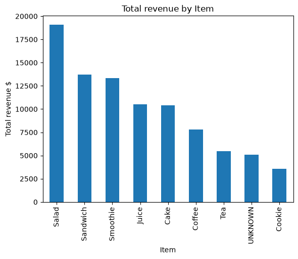
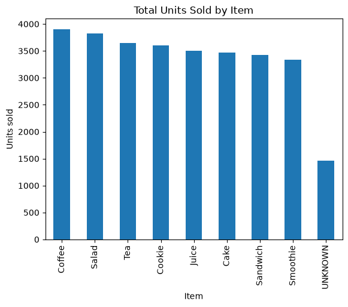

# Cafe Sales Data Cleaning

Cleaning a deliberately messy dataset of 10,000 cafe transactions with Python and pandas, then a short analysis of revenue and units sold by item.

The main idea of this project: **recover missing values using the relationships between columns before deciding what to drop or label as unknown.**

---

## Dataset

- **Source:** [Cafe Sales - Dirty Data for Cleaning Training](https://www.kaggle.com/datasets/ahmedmohamed2003/cafe-sales-dirty-data-for-cleaning-training) (Kaggle, CC BY-SA 4.0)
- **Size:** 10,000 rows, 8 columns
- **Columns:** Transaction ID, Item, Quantity, Price Per Unit, Total Spent, Payment Method, Location, Transaction Date
- Each row is one transaction for one type of item.

---

## Problems Found

| Problem | Example |
|---|---|
| Missing values in almost every column | Empty cells |
| Placeholder text instead of real values | `ERROR`, `UNKNOWN` |
| Numbers and dates stored as text | `'2.0'` instead of `2.0` |

`isnull()` only counted the empty cells at first. After converting `ERROR` and `UNKNOWN` to real missing values, the true picture was much larger:

| Column | Empty cells only | After converting ERROR / UNKNOWN |
|---|---|---|
| Item | 333 | 969 |
| Quantity | 138 | 479 |
| Price Per Unit | 179 | 533 |
| Total Spent | 173 | 502 |
| Payment Method | 2,579 | 3,178 |
| Location | 3,265 | 3,961 |
| Transaction Date | 159 | 460 |

---

## Cleaning Steps

### 1. Standardize missing values
Replaced `ERROR` and `UNKNOWN` with `NaN` across the whole table, so every kind of "we don't know" had one form.

### 2. Convert data types
Converted Quantity, Price Per Unit and Total Spent to numbers with `pd.to_numeric`, and Transaction Date to datetime with `pd.to_datetime`.

### 3. Recover Item from Price
Every item has one fixed price. Four prices belong to only one item, so they identify the item exactly:

| Price | Item |
|---|---|
| 1.0 | Cookie |
| 1.5 | Tea |
| 2.0 | Coffee |
| 5.0 | Salad |

Prices 3.0 (Cake or Juice) and 4.0 (Sandwich or Smoothie) are shared by two items, so they were **left out on purpose**. Guessing would put wrong data into the table.

A dictionary + `map` + `fillna` filled only the empty items and left the ambiguous ones empty.

### 4. Recover Price from Item
Used `groupby('Item')` with `transform('first')` inside `fillna` to fill missing prices from each item's known price, without overwriting existing values.

### 5. Recover numbers with math
The three numeric columns are connected:

```
Total Spent = Quantity × Price Per Unit
```

When one value was missing and the other two were known, it was calculated:
- Price = Total ÷ Quantity
- Total = Quantity × Price
- Quantity = Total ÷ Price

After new prices were calculated, the item recovery step was run again, which recovered more items.

### 6. Handle what could not be recovered
- **Numeric columns:** 26 rows still had two of the three numbers missing, so they could not be calculated. These rows were dropped (0.26% of the data).
- **Item, Payment Method, Location:** filled with the label `UNKNOWN`. Dropping them would have removed up to 40% of the data (Location).
- **Transaction Date:** 460 missing dates were **kept as missing**. These rows are real sales with complete item and price data, and no other column can predict a date. Dropping them would lower total revenue.

### 7. Validate
Checked that `Quantity × Price Per Unit = Total Spent` in every row. Result: **0 mismatches** across all 9,974 rows.

---

## Recovery Results

| Column | Missing after ERROR/UNKNOWN conversion | Recovered | Final handling |
|---|---|---|---|
| Item | 969 | 489 | 474 labeled `UNKNOWN` |
| Price Per Unit | 533 | 527 | 6 left, rows dropped |
| Quantity | 479 | 456 | 23 left, rows dropped |
| Total Spent | 502 | 479 | 23 left, rows dropped |

Some rows were missing more than one of these values, so only **26 rows** were dropped in total.

**Final dataset:** 9,974 rows (from 10,000), no missing values except 460 transaction dates.

---

## Analysis

### Total revenue by item


### Total units sold by item


### Key findings
- All eight items sold in similar amounts: roughly **3,300 to 3,900 units** each.
- Revenue, however, is very different: **Salad earned about $19,100**, while **Cookie earned about $3,600**.
- **Coffee sold the most units but ranks only sixth in revenue**, because of its low price.
- Differences in revenue come from **price, not popularity**. Selling more of the higher-priced items (Salad, Sandwich, Smoothie) would raise revenue more than selling more Coffee or Cookies.
- About $5,100 of revenue belongs to transactions where the item could not be identified.

---

## Tools

- Python
- pandas
- NumPy
- Matplotlib
- Jupyter Notebook (VS Code)

---

## Files

| File | Description |
|---|---|
| `cafe-sales-cleaning.ipynb` | Full cleaning and analysis notebook |
| `dirty_cafe_sales.csv` | Original dataset |
| `cleaned_cafe_sales.csv` | Cleaned dataset |
| `total_revenue.png` | Revenue by item chart |
| `units_sold.png` | Units sold by item chart |
